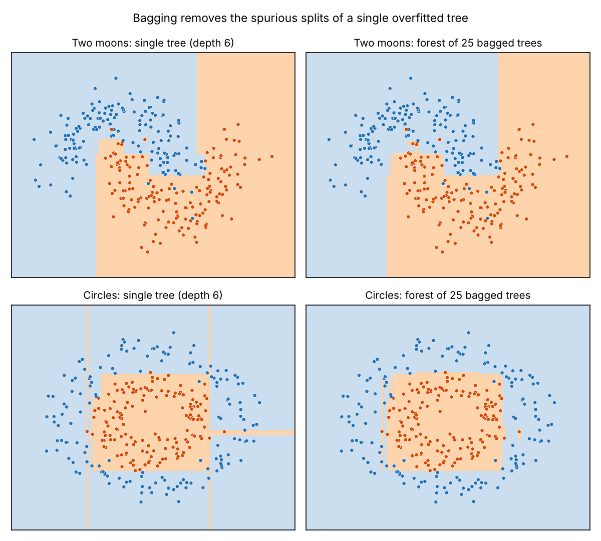
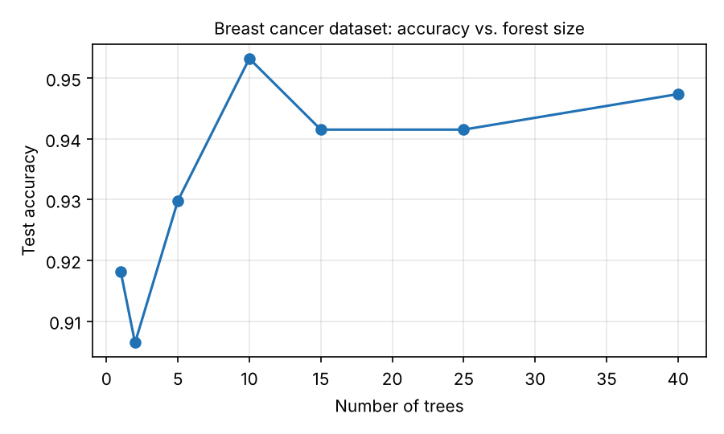

# Random Forest from Scratch

A random forest classifier written in plain NumPy (no ML library in the model), from the impurity of a single node up to a bagged ensemble that votes. scikit-learn is used only to load datasets and as a reference for comparison.



## Results

Test accuracy on a stratified 70/30 split (25 trees, maximum depth 6, seed 0), reproduced by `python benchmark.py`:

| Dataset | Samples × features | Single tree (mine) | Forest (mine) | scikit-learn forest |
| --- | --- | --- | --- | --- |
| Breast cancer | 569 × 30 | 0.918 | **0.942** | 0.936 |
| Wine (3 classes) | 178 × 13 | 0.889 | **0.963** | 1.000 |
| Two moons (noisy) | 400 × 2 | 0.842 | 0.825 | 0.908 |

On the two real datasets, bagging clearly beats a single tree and gets close to scikit-learn. The two-moons case shows the limits of the design choice explained below.



## What is implemented (`model.py`)

| Block | Functions |
| --- | --- |
| Node impurity and split quality | `impurity` (Gini), `split_dataset`, `split_score` (impurity decrease), `best_split` (exhaustive search over midpoints) |
| Decision tree | `should_stop`, `leaf_prediction` (majority vote), `build_tree` (recursive, dict-based), `predict_example_tree`, `predict_tree` |
| Forest | `bootstrap_sample`, `feature_subset`, `train_forest`, `combine_predictions` (majority vote), `predict_forest`, `accuracy` |

## Design note: feature sampling per tree, not per split

`train_forest` draws one random subset of √d features **per tree** and reuses it for every split of that tree (the *random subspace* method). Breiman's random forest, used by scikit-learn, redraws the subset **at every split**.

- With many features (breast cancer: 5 of 30 per tree), the two approaches perform about the same.
- With only 2 features, √2 rounds to 1: each tree sees a single coordinate and can only draw axis-aligned stripes. That is why the forest loses to a single tree on two moons. The decision-region figure is drawn with both features per tree to isolate the effect of bagging.

Natural next step: move the feature draw inside `best_split` to sample per split.

## Run it

```bash
pip install numpy scikit-learn matplotlib
python scaffold.py     # quick check on a synthetic dataset
python benchmark.py    # comparison table and figures
```

## Files

```
model.py        my implementation (15 functions)
scaffold.py     small driver provided with the exercise
benchmark.py    comparison with scikit-learn, figures
figures/        generated plots
```

---
Guided project from [Deep-ML](https://www.deep-ml.com): the step-by-step structure and `scaffold.py` come from the exercise; every function in `model.py` is my own solution.
