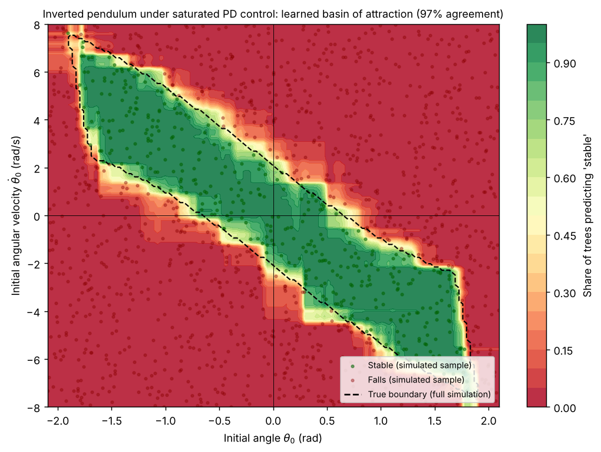
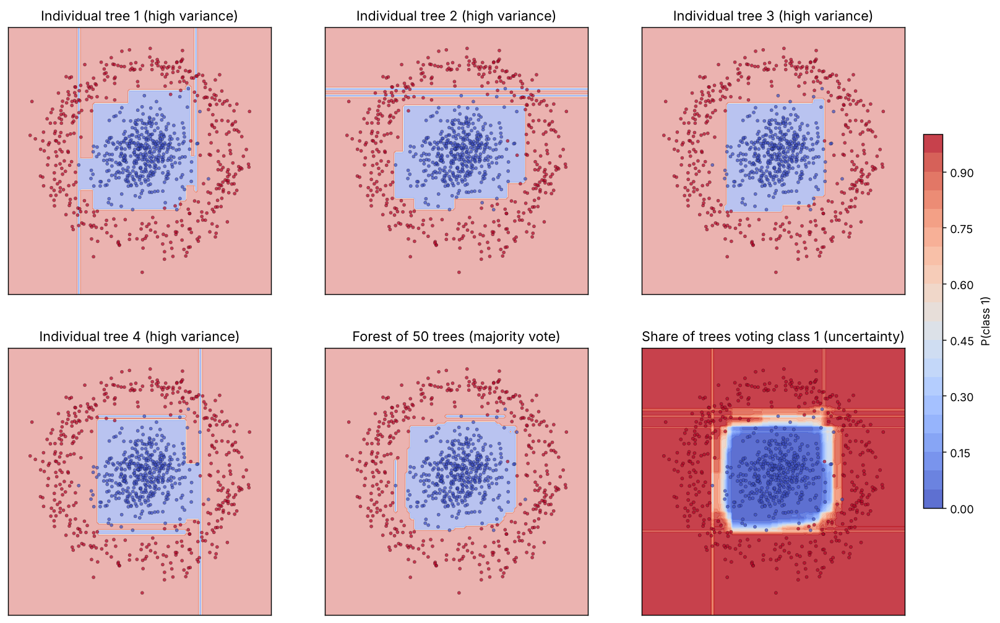
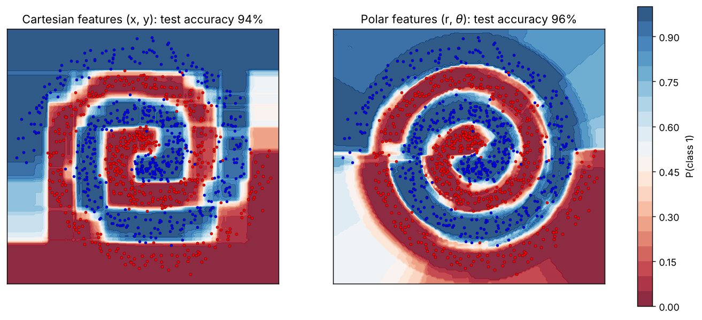
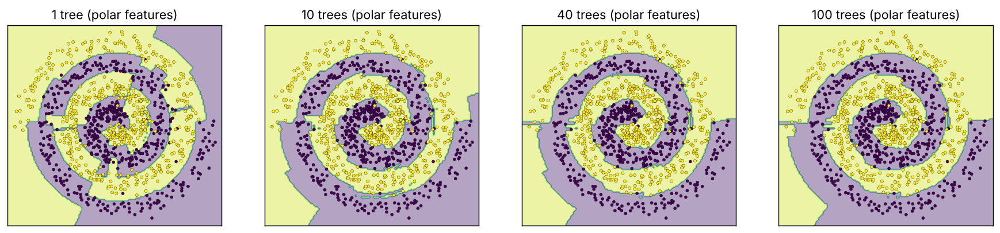
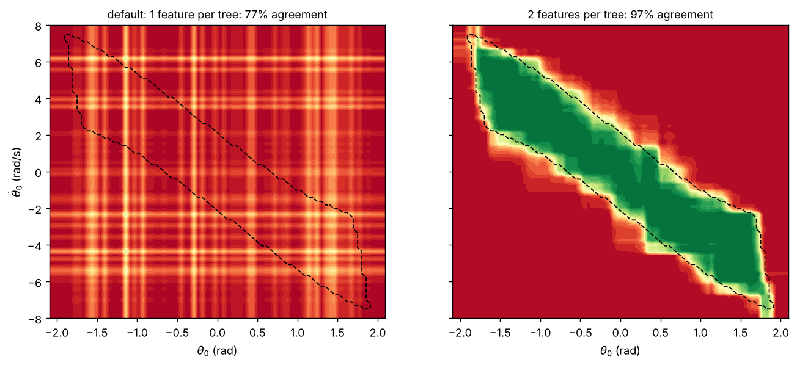

# Random Forest from Scratch

A random forest classifier written in plain NumPy, from the impurity of a single node up to a bagged ensemble that votes, plus visual experiments that show what the forest actually learns. The headline one: learning which initial states an inverted-pendulum controller can recover.



## Visual experiments (`examples/`)

All scripts use only `model.py` for the learning part and save their figure in `figures/` (add `--show` to open a window).

### 1. Learning the stability region of a controller: `pendulum_basin.py`

An inverted pendulum is stabilised by a PD controller (Kp = 15, Kd = 5) whose command is **saturated** at 6 rad/s², below gravity at large angles. Whether the controller recovers the pendulum then depends nonlinearly on the initial state (θ₀, θ̇₀).

- 1,500 random initial states are simulated for 3 s (explicit Euler, dt = 0.05 s). A state is labelled *stable* if the pendulum ends within 0.5 rad of upright, with |θ̇| < 1 rad/s, without ever passing ±π/2.
- The forest (50 trees, depth 12) learns the basin of attraction **from these labels only**, with no model of the dynamics.
- To check it, every point of a 120 × 120 grid is simulated as well, giving the true boundary (dashed line). The forest's prediction agrees with the simulation on **97 %** of the grid.

The shape makes physical sense. The basin is a diagonal band: a state with an angle to the right needs a velocity pointing back to the left to be saved. With zero initial velocity, only angles up to about 0.5 rad are recovered; beyond arcsin(6/9.81) ≈ 0.66 rad the saturated command cannot even balance gravity. The band stops just beyond ±π/2 because a state counts as fallen as soon as |θ| > π/2. The colour scale is the share of trees voting "stable", so the forest also shows where it is unsure: along the boundary.

### 2. Why a forest beats its trees: `bagging_variance.py`



Data: a dense cluster (class 0) inside a noisy ring (class 1). Each tree is grown deliberately deep (depth 15) on its own bootstrap sample, so each one overfits in its own way: spurious stripes and notches that differ from tree to tree. The majority vote of 50 trees cancels most of them. The last panel shows the **share of trees voting class 1**: deep red or blue where the trees agree, white (≈ 50 %) at the boundary. The free uncertainty estimate is a direct by-product of bagging.

The square shape of the boundary is also instructive: every split is axis-aligned, so a circle can only be approximated by a staircase.

### 3. Feature engineering: `spirals_feature_engineering.py`



Two interleaved spirals are hard for axis-aligned splits. The same forest is trained on two representations of the same points:

| Inputs | Test accuracy (1,000 fresh points) |
| --- | --- |
| Cartesian (x, y) | 94.2 % |
| Polar (r, θ) | **96.1 %** |

In polar coordinates the arms become much more regular, and the boundary follows the spiral instead of a grid of rectangles. The visible seam on the left is where θ jumps from +π to −π: points on either side are close in the plane but far apart in feature space, a classic side-effect of angular features.



As trees are added (1 → 10 → 40 → 100), the noisy regions of the single tree disappear and the boundary stabilises.

### 4. A pitfall found with these plots: `feature_sampling_pitfall.py`



`train_forest` draws round(√d) features **once per tree** and keeps them for all its splits (the *random subspace* method). Breiman's random forest, used by scikit-learn, redraws them **at every split**.

With only 2 features, √2 rounds to 1: each tree sees θ **or** θ̇, never both, and can only draw stripes. On the pendulum, the default forest scores 77 % agreement. That is exactly the score of always answering "falls" (77 % of the grid is unstable), so it learned nothing. With both features per tree it reaches 97 %. The 2-D examples above therefore set `num_features_per_split=2`, which is plain bagging.

**Next step:** move the feature draw inside `best_split`, so each split samples √d features. A forest of 2-D trees could then still use both coordinates.

## Benchmark against scikit-learn

Test accuracy on a stratified 70/30 split (25 trees, maximum depth 6, seed 0), reproduced by `python benchmark.py`:

| Dataset | Samples × features | Single tree (mine) | Forest (mine) | scikit-learn forest |
| --- | --- | --- | --- | --- |
| Breast cancer | 569 × 30 | 0.918 | **0.942** | 0.936 |
| Wine (3 classes) | 178 × 13 | 0.889 | **0.963** | 1.000 |
| Two moons (noisy) | 400 × 2 | 0.842 | 0.825 | 0.908 |

With many features, per-tree sampling still works well. The two-moons line is the pitfall above.

## What is implemented (`model.py`)

| Block | Functions |
| --- | --- |
| Node impurity and split quality | `impurity` (Gini), `split_dataset`, `split_score` (impurity decrease), `best_split` (exhaustive search over midpoints) |
| Decision tree | `should_stop`, `leaf_prediction` (majority vote), `build_tree` (recursive, dict-based), `predict_example_tree`, `predict_tree` |
| Forest | `bootstrap_sample`, `feature_subset`, `train_forest`, `combine_predictions` (majority vote), `predict_forest`, `accuracy` |

## Run it

```bash
pip install -r requirements.txt
python scaffold.py                         # quick check on a synthetic dataset
python examples/pendulum_basin.py          # any example; add --show to open the figure
python benchmark.py                        # comparison table
```

The implementation is pure Python recursion, so the grid-based examples take one to two minutes each.

## Files

```
model.py                 my implementation (15 functions)
examples/                visual experiments described above
benchmark.py             comparison with scikit-learn
scaffold.py              small driver provided with the exercise
figures/                 generated plots
```

---
Guided project from [Deep-ML](https://www.deep-ml.com): the step-by-step structure and `scaffold.py` come from the exercise; every function in `model.py` is my own solution. The experiments in `examples/` are my own scripts, cleaned up and extended (ground-truth check, held-out accuracy, pitfall comparison) with the help of an AI assistant.
